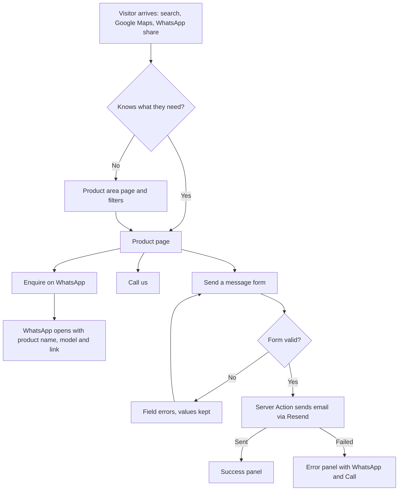
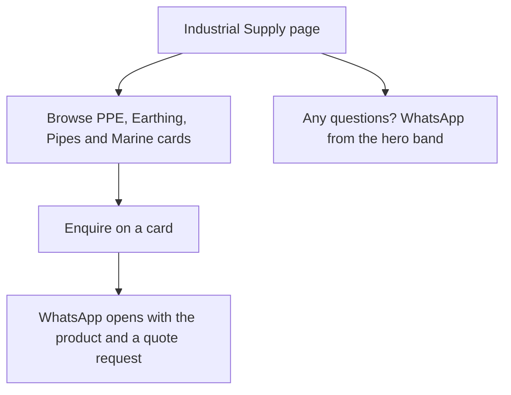
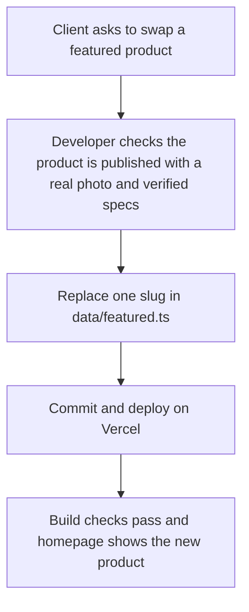

# design.md: KGICL Goodnews Solar Website

**Stage 4 of the workflow:** Brainstorm → Requirements → PRD → **design.md** → task.md files
**Rev:** 1.0 · **Date:** 25 October 2026 · **Inputs:** PRD Rev 1.0, coming-soon page (00-coming-soon-page.md), approved logo set

> **Agent Context.** This file is the single source of truth for the website's look and behaviour. Build UI from the tokens and components here. Do not invent colours, fonts, spacing or component styles. If something is missing, extend this file first (note it in the PR). Functional rules live in the PRD. This file only decides how things look and feel.

---

## 1. Design principles

1. **Trustworthy before clever.** Real photos, real address, clear warranty terms. No decoration that competes with products.
2. **WhatsApp-first.** Every screen has one obvious way to ask a question. The action never needs more than one tap.
3. **Premium, not precious.** Dark, confident framing (as on the coming-soon page) around light, easy-to-read catalogue pages.
4. **Fast on a cheap phone.** Static pages, small images, a few animations, no heavy effects.
5. **Calm motion.** Motion confirms, never distracts. Everything respects reduced-motion.
6. **Plain words.** Short labels, no jargon on buttons.

## 2. Look and feel (decision summary)

| Area | Decision |
|---|---|
| Overall | **Hybrid.** Dark header, hero and footer; **light "paper" background for catalogue content**. Product photos are mostly bright shop shots, and they read better on light surfaces |
| Industrial Supply page | **Fully dark**, which signals "on request, serious supply" and sets it apart from the retail catalogue |
| Brand colour | Red `#E30613`, white and black from the client's logo. Amber used only as a small warm accent |
| Typography | *Cormorant Garamond* for headlines (matches the serif KG monogram). *Manrope* for everything else |
| Signature motif | The **dotted ring** from the logo: large, faint and slowly rotating behind the home hero; a thin dotted divider between sections; the loading and success marks. Nothing else rotates |
| Photography | Real photos only. Rounded corners, no heavy filters, no stock lookalike effects |

The home hero, its glow and its ring continue the look of the coming-soon page, so visitors see one brand from the first visit.

---

## 3. Brand and logo usage

Assets (in `public/assets/img/`): `logo-mark-white.svg`, `logo-mark-red.svg`, `logo-ring-white.svg`, `logo-monogram-white.svg`, favicons and icons. All share one `viewBox="0 0 800 800"`.

| Context | Logo | Size |
|---|---|---|
| Header (dark) | White mark | 44 px tall. Never below 44 px. Below that, use the monogram only |
| Footer (dark) | White mark | 64 px |
| Light surfaces (rare, e.g. print or OG) | Red mark | Any |
| Hero decoration | White ring at 6 to 10% opacity, 520 to 720 px | Decorative, `aria-hidden` |
| Favicon / app icons | Red tile with white monogram | Provided |

Rules: never stretch, recolour or add effects to the mark; clear space at least 25% of the mark's width on every side; red mark never on black for text-sized use (4.05:1). Next to the mark, the wordmark text reads **KGICL** (Manrope 700, tracking .12em) over **Goodnews Solar** (Manrope 500, muted).

---

## 4. Design tokens

### 4.1 Colour

| Token | Value | Use |
|---|---|---|
| `--red` | `#E30613` | Primary buttons, key accents, large red text |
| `--red-deep` | `#B1040E` | Red text on light surfaces, button hover and pressed |
| `--red-soft` | `#FF4D57` | Small red text on dark |
| `--black` | `#0A0A0B` | Header, hero, footer, Industrial page |
| `--ink-2` | `#121214` | Raised surfaces on dark |
| `--ink-3` | `#1B1B1F` | Cards on dark, borders |
| `--paper` | `#F7F6F4` | Main light page background |
| `--white` | `#FFFFFF` | Cards on light, text on dark |
| `--stone-100` | `#EFEDEA` | Image backgrounds, table stripes, chips |
| `--stone-300` | `#D8D5D0` | Borders on light |
| `--text` | `#111114` | Body text on light |
| `--text-muted` | `#55555C` | Secondary text on light |
| `--text-on-dark` | `#FFFFFF` | Text on dark |
| `--text-muted-on-dark` | `#B8B8BD` | Secondary text on dark |
| `--amber` | `#FFB020` | Accent rule, glow, small details on dark only |
| `--success` | `#1F7A45` | Success panel icon and border |
| `--danger` | `#B3261E` | Form errors (text on light) |

**Contrast (WCAG AA, checked):**

| Pair | Ratio | Use |
|---|---|---|
| `--text` on `--paper` | 17.5:1 | All body text |
| `--text-muted` on `--paper` | 6.9:1 | Secondary text |
| White on `--red` | 4.88:1 | Button labels (16 px semibold or larger) |
| White on `--red-deep` | 7.26:1 | Hover state |
| `--red` on `--paper` | 4.52:1 | Large or bold text only (≥ 18.66 px bold or 24 px). For small red text use `--red-deep` (6.7:1) |
| `--red` on `--black` | 4.05:1 | Graphics and large text only. Small red text on dark uses `--red-soft` (6.1:1) |
| `--text-muted-on-dark` on `--black` | 10:1 | Secondary text on dark |
| `--amber` on `--black` | 10.8:1 | Accent on dark. **Never** amber text on light surfaces |

### 4.2 Typography

| Role | Font | Size (mobile → desktop) | Weight / spacing |
|---|---|---|---|
| Display (hero H1) | Cormorant Garamond | `clamp(2.5rem, 6.2vw, 4.75rem)` | 600, lh 1.05, ls -0.01em |
| H2 (section titles) | Cormorant Garamond | `clamp(1.875rem, 3.4vw, 2.75rem)` | 600, lh 1.15 |
| Product name (product page H1) | Cormorant Garamond | `clamp(2rem, 4vw, 3rem)` | 600, lh 1.1 |
| H3 / card title | Manrope | 1.125rem → 1.25rem | 700, lh 1.3 |
| Body large | Manrope | 1.125rem | 400, lh 1.6 |
| Body | Manrope | 1rem | 400, lh 1.6 |
| Small | Manrope | 0.875rem | 400, lh 1.5 |
| Label / eyebrow | Manrope | 0.75rem uppercase | 600, ls 0.18em |
| Button | Manrope | 1rem | 700 |
| Spec value / model code | Manrope | 0.9375rem, tabular numbers | 600 |

Fonts are self-hosted `.woff2`, latin subset: Cormorant Garamond 600; Manrope 400, 600, 700. `font-display: swap`. Preload Cormorant 600 and Manrope 400.

### 4.3 Spacing, layout, shape

| Token | Value |
|---|---|
| Spacing base | 4 px. Use Tailwind's default scale |
| `--section-y` | 64 px (mobile), 96 px (desktop) |
| Container | max 1200 px, side padding 20 px (mobile), 32 px (md), 40 px (lg) |
| Breakpoints | sm 640 · md 768 · lg 1024 · xl 1280 |
| Radius | `--radius-sm` 10 px (inputs, chips), `--radius` 14 px (cards, buttons), `--radius-lg` 24 px (hero blocks), `--radius-pill` 999 px |
| Shadow (light surfaces) | `--shadow-1`: 0 1px 2px rgba(17,17,20,.06) · `--shadow-2`: 0 6px 20px rgba(17,17,20,.10) · `--shadow-3`: 0 14px 40px rgba(17,17,20,.16) |
| Borders | 1 px `--stone-300` (light), 1 px `rgba(255,255,255,.12)` (dark) |
| Z-index | content 0 · sticky header 40 · mobile bar 45 · floating WhatsApp 50 · menu overlay 60 · toast 70 |

### 4.4 Motion

| Token | Value |
|---|---|
| `--dur-fast` | 150 ms (hover, press) |
| `--dur` | 250 ms (menus, filters) |
| `--dur-slow` | 600 ms (entrance reveal) |
| `--ease` | `cubic-bezier(.2,.7,.2,1)` |
| Ring rotation | 120 s linear, infinite (hero decoration only) |

Animate only `transform` and `opacity`. Entrance reveal: fade up 12 px, once, with a 70 ms stagger inside a section. **No entrance animation on the hero's first screen text**, so the largest content paints at once. Under `prefers-reduced-motion: reduce`, turn off the ring rotation, reveals, glow pulse and smooth scroll.

### 4.5 Tailwind v4 setup (naming rules matter)

```css
/* app/globals.css */
@import "tailwindcss";

@theme {
  --color-red: #E30613;
  --color-red-deep: #B1040E;
  --color-red-soft: #FF4D57;
  --color-black: #0A0A0B;
  --color-ink-2: #121214;
  --color-ink-3: #1B1B1F;
  --color-paper: #F7F6F4;
  --color-white: #FFFFFF;
  --color-stone-100: #EFEDEA;
  --color-stone-300: #D8D5D0;
  --color-text: #111114;
  --color-text-muted: #55555C;
  --color-text-on-dark: #FFFFFF;
  --color-text-muted-on-dark: #B8B8BD;
  --color-amber: #FFB020;
  --color-success: #1F7A45;
  --color-danger: #B3261E;

  --font-display: var(--font-cormorant), Georgia, "Times New Roman", serif;
  --font-body: var(--font-manrope), system-ui, -apple-system, "Segoe UI", Roboto, sans-serif;

  --radius-sm: 0.625rem;
  --radius-md: 0.875rem;
  --radius-lg: 1.5rem;
  --radius-pill: 999px;

  --shadow-1: 0 1px 2px rgba(17, 17, 20, 0.06);
  --shadow-2: 0 6px 20px rgba(17, 17, 20, 0.1);
  --shadow-3: 0 14px 40px rgba(17, 17, 20, 0.16);

  --ease-brand: cubic-bezier(.2, .7, .2, 1);
}
```

**Base styles shipped with the tokens.** `app/globals.css` also defines these shared rules so every component starts from the same foundation:

- Body: `--color-paper` background, `--color-text` text, `--font-body`.
- Heading defaults: H1 and H2 use `--font-display` at 600; H3 to H6 use `--font-body` at 700. Components may override size with the type utilities below.
- Type utilities: `.type-display`, `.type-h2`, `.type-product-title`, `.type-h3`, `.type-body-lg`, `.type-body`, `.type-small`, `.type-label`, `.type-button`, `.type-spec` (values from 4.2).
- `.section-y`: 64 px block padding on mobile, 96 px from 768 px.
- `.container-site`: max 1200 px, centred, side padding 20 px (mobile), 32 px (md), 40 px (lg).
- `.skip-link`: fixed at the top-left, white pill with `--color-text`, hidden off-screen until focused; it is the first focusable element on the page.
- Focus: default `:focus-visible` ring is 3 px with 3 px offset in `--color-text`; inside a dark surface (`.on-dark`) the ring is white. Never remove it.
- Reduced motion: `prefers-reduced-motion: reduce` disables animation, transitions and smooth scrolling.

Naming rules to avoid known pitfalls:
- **Do not** name custom spacing tokens `xs`, `sm`, `md`, `lg`, `xl` or `2xl`. In Tailwind v4 these clash with the container and max-width scale (`max-w-md` can silently resolve to a tiny value). Use Tailwind's default spacing, plus distinct names such as `--section-y`.
- **next/font variable names must differ from the `@theme` names.** Set the `next/font` variables to `--font-cormorant` and `--font-manrope`, and alias them in `@theme` as `--font-display` and `--font-body` (as above). Using identical names makes the variables point to themselves and no brand font loads.
- Verify in the browser's computed styles that the headline font really is Cormorant Garamond before moving on.

---

## 5. Layout and surfaces

- **Dark bands:** header, home hero, "Why choose us" band, Industrial page, footer. Background `--black`, surfaces `--ink-2` or `--ink-3`.
- **Light bands:** everything else, background `--paper`, cards `--white` with `--shadow-1` and a 1 px `--stone-300` border.
- **Section rhythm:** `--section-y` top and bottom. A thin dotted divider (dots in `--stone-300`, 6 px apart) may separate sections. Do not use more than one divider type.
- **Grid:** 4 columns on mobile, 12 on desktop. Product grids: 1 column below 480 px, 2 from 480, 3 from 1024, 4 from 1280 (Industrial compact cards: 2 / 3 / 4).
- **Header:** sticky, solid `--black` (no transparency), 72 px tall on desktop, 64 px on mobile. A 1 px bottom border `rgba(255,255,255,.12)` appears after scroll.

---

## 6. Component inventory

Each component lists purpose, anatomy, variants, states, responsive behaviour and accessibility. Build in `components/`.

### 6.1 Navigation and shell

**Header**
- Anatomy: logo lockup (mark + wordmark) · nav (Solar Lighting, CCTV & Security, Electrical Supplies, Industrial Supply, Services, Projects, About, Contact) · WhatsApp button (primary, compact).
- Desktop (≥ 1024): inline nav, text `--text-on-dark`, hover underline in `--red-soft` (2 px). Active page: white with a red underline.
- Below 1024: logo, WhatsApp icon button, menu button. Eight links plus a button need the 1024 breakpoint.
- A11y: `<nav aria-label="Primary">`, visible focus, current page `aria-current="page"`.

**Mobile menu** (slide-in panel from the right, 88% width, backdrop dims the page)
- Links stacked at 18 px with 56 px rows; WhatsApp and Call buttons at the bottom.
- Closes on backdrop tap, Escape, link tap. Focus is trapped while open, and returns to the menu button when closed. Body scroll locked.

**Mobile action bar** (below 768 px)
- Fixed bottom bar, `--black`, two equal buttons: **WhatsApp** (red) and **Call** (outline). 56 px tall plus safe-area inset.
- Hides while the mobile menu is open or the keyboard is up. Page content gets bottom padding equal to the bar height.

**Floating WhatsApp button** (768 px and above)
- 56 px circle, `--red`, white WhatsApp glyph, bottom-right 24 px, `--shadow-3`. Tooltip "Chat on WhatsApp" on hover and focus. The link text is in an `aria-label`.

**Footer** (dark)
- Four columns on desktop: brand (mark, one-line description, "Nationwide delivery"), Products (four areas), Company (Services, Projects, About, Contact, Privacy notice), Visit us (address, hours, phones; email once confirmed).
- Social icons render only when the environment variable holds a real URL.
- Bottom line: © {year} Kris Goodnews Int'l Co. Ltd. All rights reserved.

### 6.2 Buttons and small elements

| Component | Spec |
|---|---|
| **Button, primary** | `--red` fill, white text, 52 px high (44 px compact), radius 14. Hover `--red-deep` + 1 px lift + soft red shadow. Active no lift. Disabled 50% opacity, no pointer |
| **Button, secondary (on dark)** | Transparent, 1 px white at 35% border, white text. Hover: border white, fill white at 6% |
| **Button, secondary (on light)** | Transparent, 1 px `--text` border, `--text` text. Hover: fill `--text`, text white |
| **Text link** | `--red-deep` on light, `--red-soft` on dark, underline on hover, arrow icon optional |
| **Icon** | Lucide for UI icons. WhatsApp, Facebook, Instagram and LinkedIn glyphs from react-icons (`fa`). 20 px default, `aria-hidden` unless alone in a button |
| **Chip / filter chip** | Pill, 40 px high, 1 px `--stone-300`, `--white` fill. Selected: `--text` fill, white text. Focus ring visible |
| **Eyebrow label** | Uppercase label style, `--red-deep` on light, `--red-soft` on dark, optional 24 px amber rule before it |
| **Breadcrumbs** | Small text, `--text-muted`, "/" separators, current page not a link, `aria-label="Breadcrumb"` |
| **Dotted divider** | 6 px dots, `--stone-300` on light, `--ink-3` on dark |

Focus ring (all interactive elements): 3 px outline, 3 px offset. White on dark surfaces, `--text` on light. Never remove outlines.

### 6.3 Product components

**Product card (standard)**
- Anatomy: image area (`--stone-100`, 4:3, `object-contain` with padding for product shots) · eyebrow (group) · name (H3, 2 lines max) · one key line (for example "12-Eye · 120W · 12 to 20 hours backup") · button "Enquire" (secondary, full width).
- The whole card is one link to the product page, except the button, which opens WhatsApp with the product name.
- Hover: image scales 1.03, shadow `--shadow-2`. Focus: ring on the card.
- No price. No stock badge. Never show "Photo coming soon" in production (such products are unpublished).

**Product card, family:** same layout, key line shows the range, for example "Available in 1 mm to 16 mm" or "3 W to 50 W", and the button reads "See sizes".

**Product card, compact (Industrial page, dark):** 1:1 image, `--ink-3` card, name and a one-line group label, button "Enquire". No key line.

**Featured products grid (home)**
- Six standard cards: 1 column below 480 px, 2 from 480, 3 from 1024. Section title "Popular products", with a text link "See all products" to the catalogue.

**Pillar tile (home)**
- Four tiles: image, area name (H3), one-line description, arrow. 2 × 2 on tablet, 4 across on desktop.
- **Image treatment: product-card style.** The client's photos are product shots, mostly on plain backgrounds and at modest resolution, so each tile shows its featured product `object-contain` on a `--stone-100` panel (4:3) with the text below the image on a white card. This is more reliable than a full-bleed photo with a gradient, which needs high-resolution lifestyle shots. A full-bleed tile with a dark gradient is allowed only if a real, high-resolution (1280 px wide or more) photo exists. Text on any gradient must reach 7:1.

**Wattage filter (Solar Lighting)**
- Row of filter chips: All, 80W, 100W, 120W, 150W, 180W, 200W, 300W. Horizontally scrollable on mobile, no wrapping. A live count "Showing 3 of 17" under the chips. Selection is stored in the URL (`?watt=120`) and announced to screen readers (`aria-live="polite"`).
- Empty state (no match): "No lights at this wattage yet. Ask us on WhatsApp." with a button.

**Product gallery:** one image per product at launch. Large (up to 600 px), `object-contain` on `--stone-100`, rounded 14. Built to accept more images later (thumbnail row hidden when there is only one).

**Spec table:** two columns (label, value), 1 px row dividers, label in `--text-muted`, value 600. Zebra with `--stone-100` at 50%. No unverified lines.

**Variant table (families):** a header row with column labels (for example Size, Colour, Gangs) and rows of values. Scrolls inside its own container on mobile, with a subtle right-edge fade as a hint. First column stays visible (sticky).

**Enquiry panel (product page)**
- A white card: heading "Interested in {name}?", primary button "Enquire on WhatsApp", secondary "Call us", text link "Or send a message" to the form (product prefilled), and a line "Reply within working hours. Open Mon to Fri 7am to 10pm, Sat 7am to 8pm." Sticky on desktop in the right column. On mobile it appears after the specs, and the mobile action bar carries the primary actions.

**Related products:** 3 or 4 standard cards, same group first.

### 6.4 Company components

| Component | Spec |
|---|---|
| **Page hero (inner pages)** | Dark band, 220 to 300 px tall, breadcrumb, H1 in Cormorant, one line of intro, faint ring at 6% on the right |
| **Section heading** | Eyebrow + H2 + optional intro paragraph (line length about 65 characters) |
| **Service card** | Icon (Lucide, in a 48 px red-tinted circle), H3, two-line description. On light |
| **Project card** | Photo (3:2, `object-cover`), title, location pill, type of work, 2 to 3 line description. Never shows phone numbers |
| **Stat block** | Large Cormorant number, label below. Home: "21 years of proven experience" (calculated), others only if real (for example "Nationwide delivery") |
| **Testimonial card** | Quote in Cormorant italic, name and role, optional initials avatar. The placeholder variant exists for development only (dashed border, "Placeholder" tag) and is blocked from production |
| **Hours card** | Table of days and hours, today's row highlighted, a "Open now / Closed now" pill in Nigerian time |
| **Terms list** | Four items with check icons (consultation, 1-year solar warranty, 6-month installation warranty, corporate payment terms) |
| **Social links** | Row of 40 px icon buttons, each rendered only when its variable holds a valid URL. Hidden entirely when none exist |
| **Prose (Privacy page)** | Max 70ch, H2/H3 in Manrope 700, lists with 8 px gaps, links in `--red-deep` |
| **Toast** | Not used. Form results use inline panels |

### 6.5 Forms

- **Field:** label above (Manrope 600, 0.875rem), input 52 px high, 1 px `--stone-300`, radius 10, white fill. Focus: 2 px `--text` border plus the focus ring. Error: 2 px `--danger` border, message below with an icon and `aria-describedby`. Placeholder text is a hint only and never replaces a label.
- **Select:** native `<select>` styled to match, with a chevron.
- **Textarea:** 5 rows, character hint "1000 characters max".
- **Consent checkbox:** 24 px box, label to the right with a link to the privacy notice, never pre-ticked.
- **Honeypot:** hidden off-screen, `aria-hidden`, `tabindex=-1`.
- **Submit:** primary button, full width on mobile. While sending: label "Sending…", spinner shown as the dotted ring turning, button disabled.
- **Success panel:** `--success` check circle (static), "Thank you. Your message has been sent.", reassurance line, WhatsApp button. Focus moves to this panel's heading.
- **Error panel:** `--danger` left bar, plain message, WhatsApp and Call buttons right in the panel. Focus moves to it.

---

## 7. Page wireframes

Wireframes show structure and order, not final spacing. `[D]` = dark band, `[L]` = light band.

### 7.1 Home

```
[D] HEADER   logo   Solar | CCTV | Electrical | Industrial | Services | Projects | About | Contact   [WhatsApp]
[D] HERO     eyebrow: PORT HARCOURT, NIGERIA
             Solar and electrical supplies    ( large faint rotating dotted ring )
             you can rely on.
             One supporting line (what we sell, nationwide delivery).
             [Chat on WhatsApp]  [Browse products]
             4 small chips: Solar Lighting · CCTV · Electrical · Industrial
[L] PILLARS  eyebrow + H2 "What we supply"
             [Solar] [CCTV] [Electrical] [Industrial]   (4 image tiles)
[L] FEATURED H2 "Popular products"                       See all products ->
             [card][card][card]
             [card][card][card]
[D] WHY      H2 "Why customers choose KGICL"
             [Original products with warranty] [Fast local delivery + install] [Trusted by estates, churches, businesses]
             Stat: 21 years of proven experience
[L] PROJECTS H2 "Recent projects"                        See all projects ->
             [project][project][project]
[L] TESTIMONIALS (only when real testimonials exist)
[L] SERVICES H2 "Services"   5 service cards in a row (wrap on small screens)
[D] CONTACT  H2 "Talk to us"   address · hours · [WhatsApp] [Call]
[D] FOOTER
```
Mobile: single column, the hero text is centred with the ring smaller (260 px) above the text, tiles 2 × 2, cards in one column, sticky action bar at the bottom.

### 7.2 Product area page (Solar Lighting)

```
[D] PAGE HERO   Breadcrumb: Home / Solar Lighting
                H1 Solar Lighting     intro (1 to 2 lines)
[L] FILTER BAR  [All][80W][100W][120W][150W][180W][200W][300W]     Showing 17 of 17
[L] GRID        [card][card][card]
                [card][card][card]  ... 17 cards (design groups as sub-headings if needed)
[L] HELP BAND   "Not sure which light fits? Tell us the location and we will advise."  [WhatsApp]
[D] FOOTER
```
CCTV and Electrical pages use the same structure with group headings (and no filter bar). Electrical shows five group sections, each with its own heading and cards.

### 7.3 Product page

```
[D] HEADER
[L] Breadcrumb: Home / Solar Lighting / 120W Solar Street Light, 12-Eye
[L] +------------------------+  +-------------------------------+
    |        IMAGE           |  | eyebrow: Solar Lighting       |
    |  (object-contain,      |  | H1  120W Solar Street Light,  |
    |   --stone-100)         |  |     12-Eye                    |
    |                        |  | model: KG-SL-120W   warranty  |
    +------------------------+  | summary (2 lines)             |
                                | ENQUIRY PANEL (sticky)        |
                                |  [Enquire on WhatsApp]        |
                                |  [Call us]  Or send a message |
                                +-------------------------------+
[L] Specifications (spec table)         Variants (family products only)
[L] Related products (3 to 4 cards)
[D] FOOTER
```
Mobile: image, name and model, summary, key specs, spec table, then the enquiry panel, then related. The action bar always shows WhatsApp and Call.

### 7.4 Industrial Supply (dark page)

```
[D] PAGE HERO  H1 Industrial Supply   "Supplied on request. Tell us what you need and we will quote."  [WhatsApp]
[D] GROUP: PPE & Safety             (12 compact cards)
[D] GROUP: Earthing & Lightning Protection   (12 compact cards)
[D] GROUP: Pipes & Marine           safety pipes, anchor chains (text cards until product data exists)
[D] HOW IT WORKS  1 Tell us what you need  2 We quote  3 We deliver     [WhatsApp]
[D] FOOTER
```

### 7.5 Services, Projects, About

```
Services:  [D hero] -> [L] 5 service cards -> [L] Terms list (4 items) -> [L] Other services (secondary, simple list) -> [D] CTA band
Projects:  [D hero] -> [L] project cards, 2 columns on desktop (5 projects) -> [D] CTA band "Need something similar?"
About:     [D hero] -> [L] History text (two paragraphs) + stat -> [L] Mission | Vision (two cards) -> [L] Values (6 chips) -> [D] Why choose us -> [D] CTA band
```

### 7.6 Contact

```
[D] PAGE HERO   H1 Contact us
[L] LEFT (40%)                          RIGHT (60%)
    Address                             CONTACT FORM
    Phones (tap to call)                (name, phone, email optional, location,
    WhatsApp [button]                    need, message, consent, send)
    Hours card (open now?)
    [Get directions]  (Google Maps link)
[D] FOOTER
```
Mobile: contact details first (call and WhatsApp buttons), then the form.

### 7.7 Privacy and 404
- **Privacy:** page hero, then prose column (70ch) with a left contents list on desktop. Last-updated date at the top.
- **404:** dark, faint ring at 10%, "Page not found", one line, buttons: Home, Browse products, WhatsApp.

---

## 8. Imagery

| Use | Ratio | Fit | Cloudinary width |
|---|---|---|---|
| Product card | 4:3 | `object-contain`, padding 12 px, `--stone-100` bg | 480 |
| Product page | 4:3 or natural, max 600 px | `object-contain` | 800 and 1200 (retina) |
| Pillar tile | 4:3 | `object-contain` on `--stone-100` (or `object-cover` for a real high-res photo) | 640 |
| Project card | 3:2 | `object-cover` | 640 |
| Hero photo (optional) | 16:9 / 4:5 on mobile | `object-cover` | 1280 and 800 |
| OG image | 1200 × 630 | Brand bar plus product photo | n/a |

- `next/image` with the Cloudinary loader. Width and height are always set. Only the first image on a page is `priority`.
- Alt text pattern: product: "{Name}, {model code}". Project: "{Project title}, {location}". Decorative images use empty alt.
- Quality: consistent crops; if a photo is dark or low quality, tell the client rather than filtering it.
- Photo status: only real photos ship (see PRD). The development-only "Photo coming soon" tile is a grey block with the monogram in `--stone-300`.

---

## 9. Motion and interaction

| Element | Behaviour |
|---|---|
| Hero ring | Rotates 120 s linear. Opacity 6 to 10%. Disabled in reduced-motion |
| Hero glow | Soft red radial at top-left (about 30% opacity), amber at bottom-right (about 10%). Static |
| Section reveals | Fade up 12 px once as the section enters, 70 ms stagger between cards. Not on the hero |
| Cards | Hover: lift 2 px, shadow-2, image scale 1.03 |
| Buttons | Hover lift 1 px, active press |
| Filter chips | Selected state changes instantly. Grid fades 150 ms when filtering |
| Mobile menu | Slide 250 ms, backdrop fade |
| Form submit | Button spinner (dotted ring), result panel fades in |
| Scroll | Native. No scroll-jacking or parallax |

---

## 10. Accessibility patterns

- Skip link "Skip to content" as the first focusable element.
- Landmarks: `header`, `nav` (labelled), `main`, `footer`. One H1 per page. Headings never skip a level.
- Focus: visible ring everywhere (6.2). Menu and dialogs trap and restore focus.
- Targets 48 px minimum on touch (buttons 52 px).
- Colour is never the only signal (selected filter also changes weight and shows a check).
- Tables have `<th scope>` headers. Scrollable table regions are keyboard focusable with an accessible name.
- Forms: labels, `aria-invalid`, `aria-describedby`, error summary announced with `role="alert"`.
- Reduced motion respected (4.4). Zoom to 200% and 400% without horizontal scroll (tables scroll in their own container).
- Link text is meaningful. Icon-only buttons have an `aria-label`.

---

## 11. Voice, labels and message templates

**Voice:** direct, helpful, professional. Short sentences. No hype words ("best", "premium", "cutting-edge"). Nigerian English spelling where it matters is fine, but keep it neutral and clear.

| Place | Label |
|---|---|
| Product button (card) | Enquire |
| Product button (page, primary) | Enquire on WhatsApp |
| Family card button | See sizes |
| Phone | Call us |
| Form link | Or send a message |
| Header button | WhatsApp |
| Empty filter | "No lights at this wattage yet. Ask us on WhatsApp." |
| Form error (send failed) | "Sorry, we couldn't send your message. Please message us on WhatsApp or call us instead." |
| Form success | "Thank you. Your message has been sent. We will get back to you shortly." |

**WhatsApp messages** (URL-encode them):
- General: `Hello KGICL, I'd like to make an enquiry.`
- Product: `Hello KGICL, I'm interested in the {product name} ({model code}). {page URL}`
- Industrial: `Hello KGICL, I'd like a quote for: {product name}. {page URL}`

---

## 12. User flows







---

## 13. Build notes for the task files

- Build tokens and global styles first (task 01), then components in this order: Button, Chip, Header and menu, Footer, action bars, Product card, Spec and variant tables, Forms, then page sections.
- Keep components server components unless they need state (menu, filter chips, form, floating button, reveal wrapper).
- Every component gets its states built at once (default, hover, focus, active, disabled, error where relevant).
- Do not add third-party UI libraries. Tailwind and a few small custom components are enough.
- After each task, check the page at 320, 390, 768, 1024 and 1440 px, and with the keyboard only.

---

## 14. Design decisions log and open questions

**Decided (defaults, easy to change):**
1. Hybrid dark and light theme. Industrial page fully dark.
2. Primary buttons are red, including WhatsApp (white WhatsApp glyph), so the brand colour stays consistent. The floating button is also red.
3. Header is solid black, not transparent.
4. The dotted ring is the only recurring motif and only the hero ring rotates.
5. One image per product at launch. Gallery is built to grow.
6. No price, no stock badge, no "New" or "Sale" badges.
7. Open/closed pill uses Nigerian time (WAT, UTC+1).

8. **Home tiles use a product photo each** (confirmed), in the product-card treatment (6.3). Solar and Electrical use their featured products. CCTV and Industrial have no featured product, so each needs one real, good-resolution product photo chosen (see Open item 2).
9. **Wordmark "KGICL Goodnews Solar" beside the mark** (confirmed by the client).
10. **Industrial page keeps the 3-step "How it works" band** (confirmed).

**Open (decide before the first UI task):**
1. **Hero imagery.** The client cannot send original street-light photos and asks us to use what is available. The two available photos are 640 × 640 px and are unconfirmed (they look like stock images and show no visible solar panel). Full-width hero use is not possible at that size. Options:
   - **A (recommended):** ring-motif hero with the dark glow, as on the coming-soon page. No photo needed, looks complete, and a photo slot stays in the layout.
   - **B:** a framed photo panel (about 480 to 560 px square, rounded) on the right of the hero, using one street-light photo. Only if it is confirmed to be a real KGICL installation, and without a location caption unless the location is confirmed.
2. **Tile photos.** CCTV tile: **Indoor Dome CCTV Camera (P-018)**, the only photo near 1000 px (810 × 810). Industrial tile: suggested **Electrical Safety Helmet (P-052)** (466 × 577 px, informal but looks like the shop's own photo), shown small in the product-card treatment; replace with a cleaner shot when one exists. Both must be classed as real. If not, the tile shows a dark gradient with the dotted ring, never a stock image.
